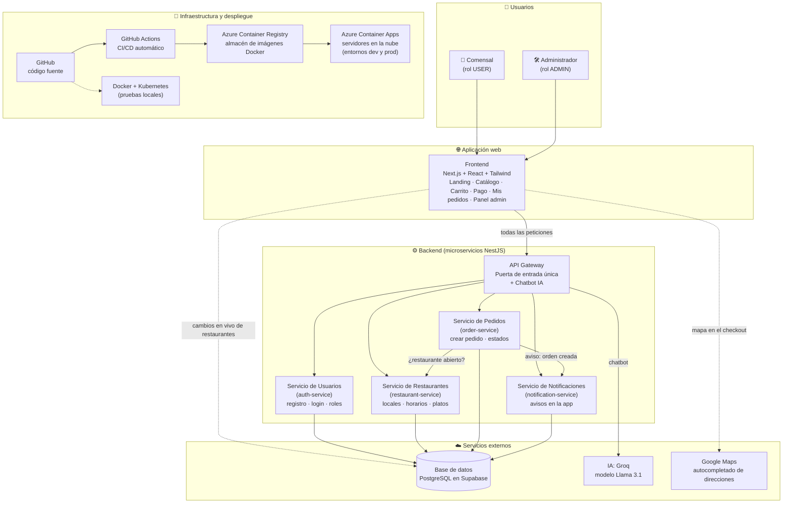
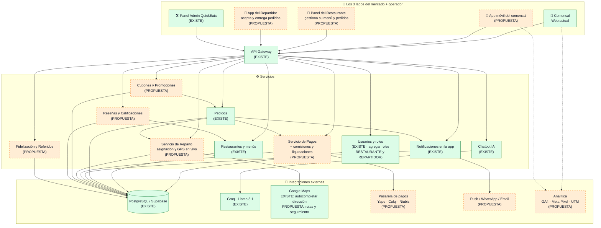

# 02 · Arquitectura de QuickEats

> Dos diagramas en Mermaid:
> 1. **Arquitectura actual**: lo que existe hoy en el código.
> 2. **Arquitectura propuesta**: cómo crecería para ser un mercado multilateral (comensales, restaurantes y repartidores).
>
> Los diagramas se pueden pegar en [mermaid.live](https://mermaid.live) para exportarlos como imagen (PNG o SVG) e insertarlos en el Word.

---

## 1. Arquitectura actual (implementada)

### Explicación en lenguaje sencillo

Piensa en QuickEats como un **restaurante grande con un mozo central**:

| Pieza | Analogía | Qué hace |
|---|---|---|
| **Frontend** (la web) | El salón y la carta | Es lo que el cliente y el administrador ven y tocan: botones, fotos, carrito y formularios. |
| **API Gateway** | El mozo principal | Recibe todos los pedidos de la web y los lleva a la "cocina" correcta. La web nunca habla directamente con los servicios. |
| **Microservicios** | Las estaciones de la cocina | Cada uno se especializa en una sola tarea: **usuarios** (quién eres), **restaurantes** (locales y platos), **pedidos** (qué compraste y en qué estado va) y **notificaciones** (avisos). Si uno falla, los demás siguen funcionando. |
| **Base de datos** (PostgreSQL en Supabase) | La despensa y el archivo | Guarda toda la información: usuarios, restaurantes, platos, pedidos y avisos. |
| **IA (Groq / Llama 3.1)** | Un asistente que entiende lenguaje humano | Permite escribir "ponme un par de hamburguesas" y que el sistema lo convierta en una acción real en el carrito. |
| **Google Maps** | Un mapa de la ciudad | Ayuda al cliente a escribir y ubicar su dirección de entrega. |
| **Docker** | Táperes estandarizados | Empaqueta cada pieza para que funcione igual en cualquier computadora o servidor. |
| **Kubernetes** | El jefe de cocina que reparte el trabajo | Organiza y vigila todos los "táperes" (contenedores). Se usó en pruebas locales. |
| **GitHub + GitHub Actions** | La receta guardada y el ayudante que la prepara solo | Cada vez que el equipo actualiza el código, se construye automáticamente una nueva versión. |
| **Microsoft Azure** | El local alquilado en la nube | Donde la plataforma estuvo publicada en internet, con un entorno de pruebas (dev) y uno de producción (prod). |

### Por qué esta arquitectura importa para el negocio
- **Escalabilidad:** si en hora punta llegan muchos pedidos, se puede reforzar solo el servicio de pedidos sin tocar el resto.
- **Rapidez para lanzar mejoras:** los servicios están separados, así que se puede agregar uno nuevo (por ejemplo, cupones o repartidores) sin rehacer la plataforma.
- **Confiabilidad:** el despliegue automático reduce los errores humanos al publicar cambios.

> ⚠️ **Estado actual del despliegue:** a la fecha de este documento, la versión publicada en Azure **ya no está en línea** (los dominios dejaron de existir) y el proyecto de base de datos en Supabase tampoco responde. El código está completo y se puede volver a levantar, en local o en la nube.

---

## 2. Arquitectura propuesta: plataforma multilateral

> Leyenda: **verde = ya existe** · **naranja con línea punteada = propuesta (no existe)**

### Qué agrega cada pieza propuesta y por qué

| Pieza propuesta | Para qué lado del mercado | Qué resuelve |
|---|---|---|
| **Panel del Restaurante** | Restaurante | Hoy solo el administrador de QuickEats puede cargar menús y cambiar estados. Con este panel, cada restaurante gestiona sus platos, horarios y pedidos. Es lo que convierte a QuickEats en un **mercado de dos o más lados**. |
| **App del Repartidor** | Repartidor | Hoy no existen repartidores. La app les permitiría conectarse, aceptar pedidos, ver la ruta y marcar "recogido" y "entregado". |
| **Servicio de Reparto + GPS** | Comensal y repartidor | Cumple la promesa de la landing de "seguimiento en vivo en el mapa", que hoy no está implementada. |
| **Servicio de Pagos + pasarela** (Yape, Culqi, Niubiz) | Los 3 lados | Hoy el pago con tarjeta es simulado. Con una pasarela real se cobra al comensal, se retiene la comisión de la plataforma y se liquida al restaurante y al repartidor. Es el **corazón del modelo de ingresos**. |
| **Cupones y promociones** | Comensal y restaurante | Cumple la promesa de "cupones exclusivos de bienvenida" y permite campañas de adquisición. |
| **Reseñas y calificaciones** | Comensal y restaurante | Reemplaza la calificación fija de "4.8" por opiniones reales y genera confianza. |
| **Fidelización y referidos** | Comensal | Retención ("invita a un amigo", puntos). |
| **Push, WhatsApp y email** | Los 3 lados | Hoy los avisos solo se ven dentro de la web. Permite avisar fuera de la app (pedido en camino, carrito abandonado, promociones). |
| **Analítica** (GA4, Meta Pixel, UTM) | Operador / marketing | Hoy no se mide de dónde llegan los usuarios. Permite medir campañas, conversión del embudo y costo de adquisición. |
| **App móvil del comensal** | Comensal | Hoy solo hay web (adaptable a celular). |

### Resumen: existe vs. propuesto

| Componente | Estado |
|---|---|
| Web del comensal (landing, catálogo, carrito, pago, pedidos) | ✅ Existe |
| Panel de administración de QuickEats | ✅ Existe |
| API Gateway + 4 microservicios | ✅ Existe |
| Chatbot con IA (Groq / Llama 3.1) | ✅ Existe |
| Base de datos PostgreSQL (Supabase) | ✅ Existe (hoy fuera de línea) |
| Google Maps para escribir la dirección | ✅ Existe |
| Docker, Kubernetes, GitHub Actions, Azure | ✅ Existe (despliegue hoy fuera de línea) |
| Panel del restaurante | 🟠 Propuesto |
| App del repartidor | 🟠 Propuesto |
| Seguimiento GPS en vivo | 🟠 Propuesto |
| Pasarela de pagos real (Yape, Culqi, Niubiz) | 🟠 Propuesto |
| Cupones, reseñas y fidelización | 🟠 Propuesto |
| Push, WhatsApp y email | 🟠 Propuesto |
| Analítica (GA4, Meta Pixel) | 🟠 Propuesto |
| App móvil nativa | 🟠 Propuesto |
