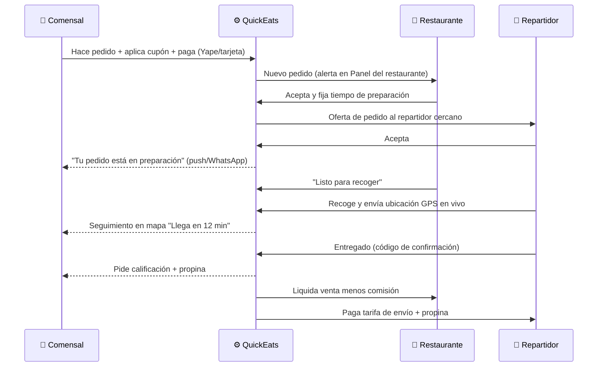

# 05 · Pantallas por diseñar (propuesta para la plataforma multilateral)

> Pantallas que **no existen** en el código y habría que diseñar (en Figma u otra herramienta) para que QuickEats sea un **mercado multilateral**, con el comensal, el restaurante y el repartidor como usuarios propios.
>
> Todas deben mantener el estilo visual de la web actual (ver `04-marca.md`).

---

## Guía de estilo para todas las pantallas nuevas

| Elemento | Valor a usar |
|---|---|
| Color primario | Ámbar `#F59E0B` · Naranja `#F97316` · degradado `#F59E0B → #F97316` |
| Hover / énfasis | Naranja `#EA580C` · Ámbar oscuro `#D97706` |
| Texto principal y bloques oscuros | Pizarra `#0F172A` |
| Texto secundario | `#64748B` · `#94A3B8` |
| Fondo general / tarjetas | `#F8FAFC` / `#FFFFFF` con borde `#F1F5F9` |
| Estados | Recibido `#4B5563`/`#F3F4F6` · Cocina `#B45309`/`#FEF3C7` · En camino `#C2410C`/`#FFEDD5` · Entregado `#15803D`/`#DCFCE7` · Cancelado `#DC2626`/`#FEE2E2` |
| Tipografía | **Poppins** Black/ExtraBold para títulos (letras juntas) · **Plus Jakarta Sans** para el texto |
| Esquinas | Tarjetas de 24 a 32 px · botones de 12 a 16 px · píldoras completamente redondas |
| Íconos | Lucide (líneas finas) |
| Componentes a reutilizar | Logo "Q" con degradado + "Quick**Eats**" · tarjetas blancas con sombra suave · badges en MAYÚSCULAS ("EXPRESS", "DESTACADO", "CERRADO") · tarjetas de métricas del panel admin (StatCard) · barra de progreso de 4 pasos de "Mis pedidos" · barra lateral colapsable del admin · píldoras de categoría con emoji |
| Formato | Comensal y repartidor: **móvil primero** (390 × 844). Restaurante: **escritorio o tablet** (1440 × 900), igual que el panel admin actual. |

> **Sugerencia para Figma:** primero crear una página de "estilos" con los colores, las 2 fuentes y los componentes de arriba. Luego tomar capturas de la web actual (ver `01-pantallas.md`) como referencia para que las pantallas nuevas se vean de la misma familia.

---

## Mapa de pantallas nuevas

| # | Pantalla | Lado del mercado | Formato | Prioridad |
|---|---|---|---|---|
| 1 | Registro de restaurante (afiliación) | 🏪 Restaurante | Web | ⭐ Alta |
| 2 | Panel del restaurante: pedidos en vivo | 🏪 Restaurante | Web / tablet | ⭐ Alta |
| 3 | Panel del restaurante: mi menú | 🏪 Restaurante | Web / tablet | Media |
| 4 | Panel del restaurante: métricas y liquidaciones | 🏪 Restaurante | Web | ⭐ Alta |
| 5 | Panel del restaurante: promociones | 🏪 Restaurante | Web | Media |
| 6 | Registro del repartidor | 🛵 Repartidor | Móvil | ⭐ Alta |
| 7 | Inicio del repartidor (conectado / desconectado) | 🛵 Repartidor | Móvil | ⭐ Alta |
| 8 | Nueva oferta de pedido | 🛵 Repartidor | Móvil | ⭐ Alta |
| 9 | Entrega en curso (navegación) | 🛵 Repartidor | Móvil | ⭐ Alta |
| 10 | Ganancias del repartidor | 🛵 Repartidor | Móvil | Media |
| 11 | Seguimiento del pedido en mapa | 🧑 Comensal | Móvil / web | ⭐ Alta |
| 12 | Cupones y promociones | 🧑 Comensal | Móvil / web | ⭐ Alta |
| 13 | Aplicar cupón en el checkout | 🧑 Comensal | Móvil / web | ⭐ Alta |
| 14 | Pago con Yape / Culqi / Niubiz | 🧑 Comensal | Móvil / web | ⭐ Alta |
| 15 | Calificar pedido (reseña) | 🧑 Comensal | Móvil / web | ⭐ Alta |
| 16 | Reseñas en el menú del restaurante | 🧑 Comensal | Móvil / web | Media |
| 17 | Invita a un amigo (referidos) | 🧑 Comensal | Móvil / web | Media |
| 18 | Admin: afiliaciones y comisiones | 🛠️ Operador | Web | Media |
| 19 | Admin: campañas y cupones | 🛠️ Operador | Web | Media |

---

## 🏪 Restaurante

### 1. Registro de restaurante ("Vende con QuickEats")
**Objetivo:** que un restaurante se afilie por sí mismo (hoy solo lo puede crear el administrador).
**Elementos:**
- Mismo diseño de pantalla dividida que el registro actual: **panel oscuro `#0F172A` a la izquierda** con el título "Vende con QuickEats" y 3 beneficios con ícono (por ejemplo "Llega a más clientes en tu zona", "Recibe pedidos en tiempo real", "Cobra de forma segura"). Formulario blanco a la derecha.
- Formulario en pasos (reutilizar el indicador de pasos del checkout): **1. Datos del negocio** (nombre comercial, razón social, RUC, categoría con las mismas píldoras con emoji) · **2. Ubicación** (buscador de Google Maps con pin, igual que el formulario actual) · **3. Contacto** (responsable, celular, correo) · **4. Horarios** (reutilizar el bloque de horarios por día) · **5. Logo y foto de portada** (subida de archivo con vista previa).
- Casilla de términos y comisión.
- Botón primario con degradado: "Enviar solicitud".
- Pantalla de confirmación: "Solicitud en revisión".

### 2. Panel del restaurante: pedidos en vivo
**Objetivo:** recibir y gestionar pedidos en tiempo real.
**Elementos:**
- **Barra lateral** igual a la del admin actual (logo, colapsable) con: Pedidos, Mi menú, Métricas, Promociones, Reseñas, Mi local. Arriba, el nombre y la foto del restaurante.
- **Interruptor grande "Abierto / Cerrado"** en la cabecera (reutilizar el interruptor de "Visibilidad").
- **Tablero tipo Kanban** con 4 columnas: **Nuevos** (con alerta sonora y borde naranja que parpadea) · **En preparación** · **Listos para recoger** · **Entregados hoy**.
- **Tarjeta de pedido:** código corto (#9E6A6404), hora, platos con cantidades, notas del cliente, método de pago (badge "Efectivo" o "Tarjeta"), total en S/ y botones **Aceptar** (degradado naranja) / **Rechazar** (secundario), con un selector de tiempo de preparación (10 / 15 / 20 / 30 min).
- Cuando el pedido está listo: botón "Listo para recoger" y estado del repartidor asignado ("Juan está a 3 min").
- Arriba, tarjetas de métricas del día (reutilizar StatCard): Pedidos hoy · Ventas hoy · Tiempo promedio de preparación.

### 3. Panel del restaurante: mi menú
**Elementos:**
- Igual a la pantalla "Productos" del admin actual, pero solo con los platos de **su** restaurante.
- Cuadrícula de tarjetas con foto, precio, interruptor **Disponible / Agotado** y la marca "Popular".
- Agrupación por categoría del menú (Entradas, Platos de fondo, Bebidas, Postres).
- Botón "Agregar plato" con formulario (reutilizar el actual) y **subida de foto** en lugar de URL.

### 4. Panel del restaurante: métricas y liquidaciones
**Elementos:**
- Selector de periodo (Hoy, 7 días, 30 días).
- Tarjetas StatCard: **Ventas brutas**, **Comisión QuickEats**, **Neto a recibir**, **Ticket promedio**, **Calificación promedio ⭐**.
- Gráfico de área de ventas por día (mismo estilo que "Ingresos por mes", color `#F59E0B`).
- "Platos más vendidos" (top 5 con foto, como "Restaurantes con más pedidos").
- "Horas pico" (gráfico de barras por hora).
- Tabla de **liquidaciones**: periodo, monto, estado (Pagado / Pendiente) y botón de descarga.

### 5. Panel del restaurante: promociones
**Elementos:**
- Lista de promociones activas en tarjetas (badge "ACTIVA" en verde, "PROGRAMADA" en ámbar).
- Botón "Crear promoción": tipo (% de descuento, monto fijo, 2x1, envío gratis), platos incluidos, fechas, horario ("Happy hour 3–6 pm") y monto mínimo.
- Opción "**Destacar mi local**" (visibilidad pagada): vista previa de cómo se verá con el badge "DESTACADO" en la landing y el catálogo.

---

## 🛵 Repartidor (app móvil)

### 6. Registro del repartidor
**Elementos:**
- Pantalla de bienvenida con el panel oscuro `#0F172A` y una ilustración de bicicleta o moto en naranja: "Reparte con QuickEats – Genera ingresos con tu propio horario."
- Pasos: **1. Datos personales** (nombre, DNI, celular, foto de perfil) · **2. Vehículo** (bicicleta, moto o auto; placa) · **3. Documentos** (subir foto del DNI, licencia, SOAT) · **4. Cuenta para pagos** (banco o Yape).
- Estado final: "Documentos en revisión".

### 7. Inicio del repartidor
**Elementos:**
- **Mapa a pantalla completa** con la ubicación propia (punto naranja `#F97316`).
- **Botón gigante** inferior: "Conectarse" (degradado naranja) o "Desconectarse" (pizarra `#0F172A`).
- Tarjeta flotante con las **ganancias de hoy** (S/), los pedidos completados y las horas conectado.
- Badge de estado: "EN LÍNEA" (verde) o "DESCONECTADO" (gris).
- Zonas de alta demanda en el mapa (manchas ámbar semitransparentes).

### 8. Nueva oferta de pedido
**Elementos:**
- Tarjeta inferior que sube sobre el mapa, con un **contador regresivo circular** (por ejemplo 30 s) en naranja.
- Restaurante (logo y nombre) → dirección del cliente (solo el distrito).
- Distancia total, tiempo estimado y **pago estimado en S/** grande, en Poppins Black.
- Badge del método de pago: "EFECTIVO: cobrar S/ 45.90" o "PAGADO".
- Botones: **Aceptar** (degradado naranja, ancho completo) · "Rechazar" (texto).

### 9. Entrega en curso
**Elementos:**
- Mapa con la ruta trazada en naranja: repartidor → restaurante → cliente.
- **Barra de progreso de 4 pasos** (reutilizar la de "Mis pedidos"): Ir al restaurante → Recoger → En camino → Entregar.
- Tarjeta con los datos del paso actual: nombre del restaurante o del cliente, dirección, **notas del cliente** ("Dpto. 302, tocar timbre"), botones "Llamar" y "Chat", y "Abrir en Google Maps".
- Lista de platos a recoger, con casillas para marcar.
- Botón principal según el paso: "Llegué al restaurante" → "Pedido recogido" → "Entregar" (con ingreso de **código de 4 dígitos** o foto de confirmación).
- Botón de ayuda o emergencia.

### 10. Ganancias del repartidor
**Elementos:**
- Selector Hoy / Semana / Mes.
- Total grande en S/ (Poppins Black, color `#0F172A`) con el desglose: tarifas de envío, **propinas** y bonos.
- Gráfico de barras por día (color `#F59E0B`).
- Historial de entregas (hora, restaurante, monto).
- Calificación promedio ⭐ y tasa de aceptación.
- Botón "Retirar a mi cuenta / Yape".

---

## 🧑 Comensal (pantallas nuevas)

### 11. Seguimiento del pedido en mapa
**Objetivo:** cumplir la promesa de la landing ("Sigue a tu repartidor en tiempo real").
**Elementos:**
- Se abre desde "Mis pedidos" en un pedido "En camino".
- **Mapa** con 3 marcadores: restaurante, repartidor (ícono de moto en una burbuja naranja) y casa (reutilizar el **pin con casita color mango `#FFB800`** que ya existe en el checkout).
- Ruta punteada en ámbar entre el repartidor y la casa.
- Tarjeta inferior (como el celular ilustrado del hero de la landing): badge "⚡ EN CAMINO", "**Llega en 12 min**" en grande, barra de progreso ámbar, foto y nombre del repartidor, vehículo y placa, y botones "Llamar" y "Chat".
- Barra de 4 pasos del pedido (la que ya existe) arriba del mapa.
- Resumen colapsable: platos, total y dirección.

### 12. Cupones y promociones
**Objetivo:** cumplir la promesa de "cupones exclusivos de bienvenida".
**Elementos:**
- Acceso desde la barra superior (ícono de ticket) o el menú de usuario.
- Pestañas: **Disponibles** · **Usados** · **Vencidos**.
- **Tarjeta de cupón** con forma de ticket (bordes recortados a los lados): monto o porcentaje grande (por ejemplo "-S/ 10" o "20%") con el degradado ámbar → naranja, título ("Bienvenida QuickEats"), condiciones (monto mínimo, restaurantes válidos), fecha de vencimiento, código (por ejemplo **BIENVENIDA10**) con botón copiar y botón "Usar ahora".
- Banner superior en el catálogo (`/user`): "🎁 Tienes 1 cupón de bienvenida".
- Campo "¿Tienes un código?" para ingresar uno manualmente.

### 13. Aplicar cupón en el checkout
**Elementos:**
- En el "Resumen del Pedido" del checkout actual, una fila nueva: "Cupón" con un campo y el botón "Aplicar".
- Cupón aplicado: chip verde con el código y una ✕ para quitarlo.
- Línea de descuento en verde (`#15803D`): "Descuento −S/ 10.00".
- Total actualizado y, debajo, "¡Ahorraste S/ 10.00!".
- Mensajes de error en rojo: "Este cupón requiere un mínimo de S/ 30".

### 14. Pago con Yape / Culqi / Niubiz
**Elementos:**
- En el paso "Método de Pago" actual, agregar opciones como tarjetas seleccionables: **Yape** (con su logo), **Tarjeta** (procesada por Culqi o Niubiz) y **Efectivo contra entrega** (ya existe).
- Yape: campo de celular y código de aprobación, con instrucciones en 2 pasos.
- Tarjeta: el formulario actual, más el texto "Pago procesado de forma segura por [pasarela]" con ícono de candado.
- Pantalla de "Procesando pago…" y luego éxito ("¡Pedido realizado con éxito! 🎉") o rechazo ("Tu pago fue rechazado. Prueba con otro método.").

### 15. Calificar pedido (reseña)
**Elementos:**
- Se abre automáticamente cuando el pedido pasa a "Entregado" (ventana sobre "Mis pedidos").
- Foto y nombre del restaurante.
- **5 estrellas** grandes en ámbar `#F59E0B`.
- Chips rápidos seleccionables: "Buen sabor", "Llegó caliente", "Buena porción", "Bien empaquetado" / "Llegó frío", "Faltó algo".
- Comentario opcional y foto opcional del plato.
- Calificación separada del repartidor (estrellas + propina opcional: S/ 2 · S/ 3 · S/ 5).
- Botón "Enviar reseña" y "Ahora no".

### 16. Reseñas en el menú del restaurante
**Elementos:**
- En la cabecera del menú actual: **calificación real** (por ejemplo "⭐ 4.6 · 128 reseñas"), reemplazando el "4.8" fijo de la landing.
- Sección "Lo que dicen los clientes": distribución de estrellas (barras ámbar), las 3 reseñas más recientes (nombre, fecha, estrellas, comentario y foto) y la respuesta del restaurante (si existe).
- En las tarjetas del catálogo: badge de calificación.
- Filtro "Mejor calificados" en el catálogo.

### 17. Invita a un amigo (referidos)
**Elementos:**
- Ilustración y título: "Invita a un amigo y ganen S/ 10 cada uno" (el monto es un ejemplo a definir).
- Código personal grande (por ejemplo **JESUS10**) con botón copiar.
- Botones para compartir: **WhatsApp** (principal), copiar enlace, Instagram y Facebook.
- Contador: "Amigos invitados: 3 · Recompensas ganadas: S/ 20".
- "¿Cómo funciona?" en 3 pasos (mismo estilo que la sección de la landing).

---

## 🛠️ Operador (QuickEats)

### 18. Admin: afiliaciones y comisiones
**Elementos:**
- Pestañas: **Restaurantes** · **Repartidores**.
- Tabla de solicitudes con nombre, fecha, documentos, estado (Pendiente / Aprobado / Rechazado) y botones Aprobar / Rechazar.
- Configuración de **comisión por restaurante** (%) y de la tarifa base de envío.
- Tarjetas StatCard: Restaurantes activos · Repartidores en línea ahora · Comisiones del mes.

### 19. Admin: campañas y cupones
**Elementos:**
- Lista de campañas con nombre, tipo, código, usos / límite, fechas y estado.
- Formulario "Crear cupón": código, tipo de descuento, monto mínimo, segmento (nuevos usuarios, inactivos hace 30 días, todos), restaurantes participantes, límite de usos y fechas.
- Métricas por campaña: cupones usados, pedidos generados, ventas atribuidas y costo del descuento.
- Panel de **origen del tráfico** (con datos de GA4 o UTM): Instagram, TikTok, Google, Facebook, Referidos.

---

## Flujo multilateral completo (para un diagrama en el informe)

> Todo este flujo es **propuesto**. Hoy solo existen el pedido del comensal (sin cupón y con pago simulado) y el cambio manual de estados por parte del administrador.
